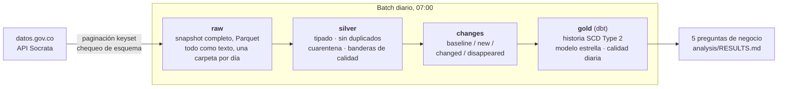

# SECOP Ledger

[English](README.md) · **Español**

[](https://github.com/JaimeGranados/secop-ledger/actions/workflows/ci.yml)

Los contratos públicos de Colombia cambian después de firmados: su estado, los pagos, la fecha de fin
y el valor. La fuente pública muestra solo la versión de **hoy**, envía duplicados y no guarda historia.

**SECOP Ledger** es un pipeline batch diario que guarda la **historia completa de 2 millones de
contratos**, nunca cuenta un registro dos veces y **demuestra cada número contra la fuente** con
reconciliaciones entre capas.

- **Fuente:** [SECOP II - Contratos Electrónicos](https://www.datos.gov.co/d/jbjy-vk9h)
  (datos.gov.co, API Socrata), contratos firmados desde el 2025-01-01: **2,010,306 filas** el 2026-11-21.
- **Stack:** Python · DuckDB · dbt · Parquet · pytest · GitHub Actions · uv. Costo: **$0**.
- **Estado:** corre todos los días desde el 2026-11-10. Airflow y la ejecución en la nube son lo
  siguiente ([hoja de ruta](#hoja-de-ruta)).

## Cifras principales

Medidas por el pipeline, historia 2026-11-10 → 2026-11-21 (6 días recolectados). Cada número sale de
[`analysis/RESULTS.md`](analysis/RESULTS.md), que se genera con SQL. Ninguno es estimado.

| Pregunta | Respuesta |
|---|---|
| ¿Cuántos contratos se modifican después de firmados? | El **25.8%** de los contratos firmados en 2025 (32.9% de los de 2026). |
| ¿Cuántos días se les agregan a los contratos? | El **22.9%** de los contratos recibió días adicionales; la prórroga mediana es de **60 días**. Interventoría (46.3%) y obra (36.0%) son los que más reciben. |
| ¿Qué tan rápido se pagan? | 6–11 meses después de firmado, el contrato mediano tenía pagado el **62.5%** de su valor; después de 12+ meses, el 87.5%. |
| ¿En qué estado están hoy? | 47.7% en ejecución, 25.2% modificados, 24.4% terminados o cerrados. |
| ¿Qué tan sucia es la fuente? | El **83.3%** de los cambios llegó **sin nueva fecha de cambio** en la fuente (`ultima_actualizacion`), así que una carga incremental sobre esa columna no los vería. |

> Que un contrato se modifique o reciba días adicionales es normal en la contratación pública. Estos
> números describen hechos; no son evidencia de que algo se haya hecho mal.

## Cómo funciona



| Capa | Qué hace | Chequeo que detiene la ejecución |
|---|---|---|
| **raw** | Descarga el slice completo cada día (81 páginas de 25,000 filas, unos 30 min) en `ingest_date=X.tmp` y luego lo renombra. Todo se guarda como texto. | filas escritas = `count(*)` de la fuente; si falta una columna en la fuente, se detiene antes de descargar |
| **silver** | Asigna tipos, limpia estados, quita duplicados idénticos, manda a cuarentena las filas inutilizables, marca las sospechosas y calcula un hash de las 7 columnas que se siguen. | raw = snapshot + cuarentena + duplicados quitados |
| **changes** | Compara el snapshot de hoy con el anterior: `new`, `changed`, `disappeared`. El día 1 es el `baseline`. | hoy = anterior + nuevos − desaparecidos |
| **gold** | Modelos dbt: `contract_history` (SCD Type 2), `dim_contract`, `dim_entity`, `dim_supplier`, `dim_date`, `fct_contract_changes`, `fct_daily_quality`. | 58 tests de dbt, incluido versiones actuales = último snapshot (hash por fila) |

El grano de cada tabla está en [`docs/data-model.md`](docs/data-model.md) (en inglés).

## Decisiones de diseño

Cada decisión sale de un número medido.

- **Un snapshot completo cada día, no una carga incremental.** La fecha de cambio de la fuente
  (`ultima_actualizacion`) estaba vacía en cerca de la mitad de los contratos, y en la práctica el
  **83.3%** de los cambios que encontró el pipeline llegó sin nueva fecha. Comparar snapshots completos
  es la única forma de ver todos los cambios. *Primero correcto, después barato.*
- **Paginación keyset sobre el id de fila (`:id > last_id`), no `$offset`.** Mientras corre una descarga
  de 30 minutos llegan filas nuevas y los offsets se corren. Además, una lectura keyset es idempotente:
  una página cortada por un error de red se puede pedir de nuevo sin riesgo.
- **Staging → reconciliar → publicar.** Un día se escribe en `ingest_date=X.tmp` y solo se renombra
  cuando su conteo coincide con la fuente. En los primeros 12 días se interrumpieron 6 ejecuciones (una
  ventana de consola cerrada, un corte de red): **ninguna publicó nada**. Un día perdido nunca es un día
  corrupto.
- **Los eventos de cambio son la historia.** `contract_history` (SCD Type 2) se construye con los
  eventos, no comparando todos los snapshots. Baseline + eventos reconstruyen cualquier día, así que los
  snapshots completos viejos se pueden borrar.
- **Versiones solo para cambios de negocio.** Solo 7 columnas abren una versión (estado, valor,
  facturado, pagado, pendiente, días adicionados, fecha de fin). Corregir un error de digitación en una
  descripción no es un cambio.
- **Los días perdidos se ven, no se esconden.** Un cambio visto después de un día perdido guarda
  `gap_days`: sabemos *que* cambió, no en qué día. `fct_daily_quality` tiene una fila por día del
  calendario, también los perdidos.
- **Cuarentena solo para lo inutilizable; lo demás se marca.** Las filas sin llave van a cuarentena.
  Las sospechosas pero usables (un contrato de 944 billones de pesos, pagado > valor) se quedan, con una
  bandera.
- **Datos personales al mínimo.** Las 20 columnas con datos personales (números de documento, cuentas
  bancarias, nombres de funcionarios) nunca se descargan. El 91% de los proveedores son personas, así
  que gold muestra el nombre del proveedor solo si es una empresa; un test de dbt falla si el nombre de
  una persona llega a gold.
- **DuckDB y Parquet, sin servidor.** 2M de filas caben en una máquina. DuckDB está limitado a 2 GB de
  RAM y 2 hilos para que el pipeline corra en un PC de escritorio compartido de 12 GB.

## Tests y CI

- **41 tests de pytest:** paginación, reintentos, cargas idempotentes (el mismo día dos veces reemplaza,
  nunca agrega), cada regla de silver, detección de cambios, el reporte.
- **58 tests de dbt:** llaves, relaciones, un unit test de la lógica SCD Type 2, sin versiones
  superpuestas, una sola versión actual por contrato, manifiestos = datos, cada día recolectado
  reconcilia, sin nombres de personas.
- **CI (GitHub Actions):** en cada PR, ruff + pytest + **el pipeline completo de punta a punta con datos
  sintéticos** ([`scripts/make_ci_fixture.py`](scripts/make_ci_fixture.py)). Los datos reales nunca
  están en git, así que el fixture crea 6 contratos falsos en 3 días con cada caso que maneja el
  pipeline: un duplicado, una fila inutilizable, un cambio sin fecha, un contrato nuevo y uno que
  desaparece, un día perdido, una persona como proveedor.

## Cómo correrlo

Necesita [uv](https://docs.astral.sh/uv/). Comandos de Windows; el Python es el mismo en cualquier
sistema operativo.

```powershell
uv sync
uv run python -m secop_ledger.ingest.collect       # raw: snapshot de hoy (unos 30 min, 530 MB)
uv run python -m secop_ledger.silver.build         # silver: cada día raw que no tenga silver
uv run python -m secop_ledger.silver.changes       # changes: cada día silver que no tenga cambios
uv run dbt build --project-dir dbt --profiles-dir dbt   # gold + 58 tests
uv run python -m secop_ledger.report               # analysis/RESULTS.md
```

`scripts/run_collector.ps1` corre los pasos en orden (cada uno solo si el anterior funcionó), después
los chequeos de datos, y está programado todos los días con el Programador de tareas de Windows.

### Monitoreo

Tres capas, cada una para una forma distinta de fallar ([`docs/runbooks.md`](docs/runbooks.md) dice
qué hacer con cada alerta; está en inglés):

| Capa | Detecta | Cómo |
|---|---|---|
| Alerta de paso | un paso termina con error | notificación al celular + correo ([ntfy](https://ntfy.sh)) con las últimas líneas del log |
| Chequeos de datos | una ejecución verde con datos malos: día perdido, fuente sin actualizar, caída de filas > 1 %, ejecución lenta | `secop_ledger.monitor.checks` después de dbt; silencioso si todo está bien |
| Heartbeat | la ejecución nunca ocurrió o se colgó (PC apagado) | [healthchecks.io](https://healthchecks.io) avisa cuando la señal **no** llega |

Las alertas nunca hacen fallar el pipeline, y la notificación al celular sale aunque el correo sea
rechazado.

### Correrlo con Airflow (opcional)

El mismo pipeline como un DAG de Airflow 3.4 (`airflow/dags/secop_daily.py`), con Docker Compose:

```powershell
docker compose -f airflow/docker-compose.yaml up -d --build   # UI: http://localhost:8080
```

```
heartbeat_start -> collect -> silver -> changes -> dbt_build -> checks -> heartbeat_ok
```

- **DAG delgado:** cada tarea llama el mismo comando que el script. La lógica y sus tests se quedan en
  el paquete. El pipeline tiene su propio entorno virtual en la imagen (desde `uv.lock`), aparte del de
  Airflow, para que sus dependencias nunca choquen.
- **Configuración liviana para un PC pequeño:** LocalExecutor + Postgres, sin Celery ni Redis. Unos
  800 MB de RAM.
- **Los reintentos son seguros porque cada paso es idempotente.** `execution_timeout` convierte un
  cuelgue en un fallo. La alerta se envía solo después del último reintento.
- **`catchup=False`, y el recolector ignora la fecha lógica:** la fuente no guarda historia, así que
  una ejecución para una fecha vieja descargaría los datos de hoy. Los días perdidos son alertas, no
  backfills.

**Por qué producción sigue en el Programador de tareas:** para un solo trabajo diario en un PC de casa,
Airflow agrega 4 contenedores y necesita Docker Desktop abierto (solo arranca cuando alguien inicia
sesión). Medido con los mismos datos: `dbt build` tarda **93 s en Docker contra 59–70 s en Windows**
(+40 %, por leer `E:` a través de WSL). Airflow es la herramienta correcta cuando hay más pipelines y
una máquina siempre encendida.

## Estructura del proyecto

```
src/secop_ledger/
  ingest/     cliente Socrata, recolector, escritor de raw (staging -> publicar)
  silver/     reglas de tipos y limpieza, detección de cambios
  monitor/    chequeos de datos, notificaciones (ntfy), heartbeat (healthchecks.io)
  report.py   corre analysis/*.sql y escribe RESULTS.md
dbt/          capa gold: staging, intermediate, marts, tests
airflow/      DAG de Airflow, Dockerfile y Docker Compose (opcional)
analysis/     las 5 preguntas de negocio (SQL) y RESULTS.md
docs/         modelo de datos (preguntas, grano, decisiones con números), runbooks
scripts/      ejecución diaria, perfil de datos, fixture de CI
tests/        pytest
```

## Límites, dichos con honestidad

- **La historia es corta y tiene huecos.** Empezó el 2026-11-10; se perdieron 6 de los primeros 12 días
  (un PC compartido en casa). La pregunta 3 compara contratos de distintas edades en un mismo día en vez
  de seguir los mismos contratos en el tiempo, y "cuánto tiempo pasa un contrato en cada estado" (pregunta 4)
  necesita meses de historia.
- **Corre en un solo PC.** Un día con el PC apagado se pierde para siempre, porque la fuente no guarda
  historia. El siguiente paso es ejecutarlo en la nube.
- **Todavía no hay un warehouse en la nube.** DuckDB local; el SQL pasa a BigQuery o Snowflake con pocos
  cambios.
- **Las fechas de la fuente no se comparan con la realidad.** Si una entidad reporta un pago tarde, el
  pipeline lo ve tarde.

## Problemas que encontré

- La API devuelve solo **1,000 filas** cuando no se le da `$limit`, sin ningún error.
- Cerrar la ventana de consola del programador de tareas mataba la ejecución: ahora la tarea corre en
  segundo plano.
- El `Retry` de urllib3 no reintenta un corte de conexión **a mitad** de una página: se agregó un
  reintento alrededor de toda la petición.
- DuckDB **copió un CTE usado dos veces** y tuvo que escribir a disco: de 480 s a 31 s con una sola
  función de ventana (`QUALIFY`).
- Un archivo de 4 bytes que quedó en una carpeta `.tmp` rompía toda consulta que usaba el glob `*/`:
  ahora las fuentes solo leen días terminados (`ingest_date=*[0-9]/`).
- El PC **entró en suspensión a mitad de una descarga**, y mientras tanto la fuente recargó el dataset.
  Cada recarga le da a cada fila un **`:id` nuevo**, así que la lectura por keyset siguió en otro espacio
  de ids y leyó unas 750,000 filas dos veces. El chequeo de conteo lo detectó (el día se perdió, no se
  dañó). Ahora el recolector compara la versión de la fuente (`rowsUpdatedAt`) antes y después y vuelve
  a leer si cambió, y mantiene el PC despierto mientras descarga.
- En Airflow, una ejecución manual con fecha lógica anterior a `start_date` sale verde pero **no corre
  ninguna tarea**.

## Hoja de ruta

- [x] Snapshot raw diario con reconciliación
- [x] Silver: tipos, sin duplicados, cuarentena, banderas
- [x] Detección de cambios e historia SCD Type 2 (dbt)
- [x] Modelo estrella, calidad diaria, las 5 preguntas de negocio
- [x] CI con una ejecución de punta a punta con datos sintéticos
- [x] Alertas cuando una ejecución falla o un chequeo encuentra algo mal, más un heartbeat
- [ ] Ejecución en la nube (GitHub Actions + almacenamiento de objetos) para no perder días
- [x] DAG de Airflow con reintentos y timeouts, Docker Compose (opcional; producción en el Programador de tareas)
- [ ] Snapshot diario reducido y política de retención para raw
