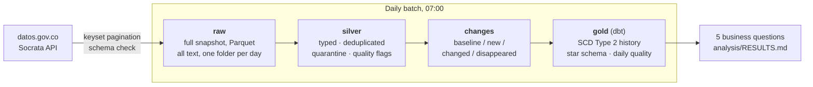

# SECOP Ledger

[](https://github.com/JaimeGranados/secop-ledger/actions/workflows/ci.yml)

Colombian public contracts change after they are signed: their status, payments, end date and
value. The public source shows only **today's** version, sends duplicates, and keeps no history.

**SECOP Ledger** is a daily batch pipeline that keeps the **full history of 2 million contracts**,
never counts a record twice, and **proves every number against the source** with reconciliation
checks between layers.

- **Source:** [SECOP II - Contratos Electrónicos](https://www.datos.gov.co/d/jbjy-vk9h)
  (datos.gov.co, Socrata API), contracts signed since 2025-01-01: **2,010,306 rows** on 2026-11-21.
- **Stack:** Python · DuckDB · dbt · Parquet · pytest · GitHub Actions · uv. Cost: **$0**.
- **Status:** running every day since 2026-11-10. Airflow and a cloud runner are next ([roadmap](#roadmap)).

## Headline numbers

Measured by the pipeline, history 2026-11-10 → 2026-11-21 (6 days collected). Every number comes from
[`analysis/RESULTS.md`](analysis/RESULTS.md), which is generated from SQL. None is estimated.

| Question | Answer |
|---|---|
| How many contracts are modified after signing? | **25.8%** of the contracts signed in 2025 (32.9% of 2026). |
| How many days are added to contracts? | **22.9%** of contracts got added days; median extension **60 days**. Supervision (46.3%) and public works (36.0%) get them most. |
| How fast are contracts paid? | 6–11 months after signing, the median contract had **62.5%** of its value paid; after 12+ months, 87.5%. |
| Where are contracts now? | 47.7% in execution, 25.2% modified, 24.4% finished or closed. |
| How dirty is the source? | **83.3%** of the changes had **no new change date** in the source (`ultima_actualizacion`), so an incremental load on that column would miss them. |

> A modified contract or added days are normal in public contracting. These numbers describe
> facts; they are not evidence that anything was done wrong.

## How it works



| Layer | What it does | Check that stops the run |
|---|---|---|
| **raw** | Downloads the full slice every day (81 pages of 25,000 rows, about 30 min) into `ingest_date=X.tmp`, then renames it. Every value is stored as text. | rows written = source `count(*)`; a missing source column stops it before downloading |
| **silver** | Types, cleans statuses, removes identical duplicates, sends unusable rows to quarantine, flags suspicious ones, adds a row hash of the 7 tracked columns. | raw = snapshot + quarantine + duplicates removed |
| **changes** | Compares today's snapshot with the last one: `new`, `changed`, `disappeared`. Day 1 is the `baseline`. | today = previous + new − disappeared |
| **gold** | dbt models: `contract_history` (SCD Type 2), `dim_contract`, `dim_entity`, `dim_supplier`, `dim_date`, `fct_contract_changes`, `fct_daily_quality`. | 58 dbt tests, incl. current versions = latest snapshot (row hash) |

The grain of every table is in [`docs/data-model.md`](docs/data-model.md).

## Design decisions

Each decision comes from a measured number.

- **A full snapshot every day, not an incremental load.** The source's change date
  (`ultima_actualizacion`) was empty for about half of the contracts, and in practice **83.3%** of the
  changes the pipeline found came with no new change date. Comparing full snapshots is the only way to
  see every change. *First correct, then cheap.*
- **Keyset pagination on the row id (`:id > last_id`), not `$offset`.** Rows are added while a
  30-minute download runs, and offsets shift. Keyset reads are also idempotent, so a page broken by
  a network error is safely asked again.
- **Staging → reconcile → publish.** A day is written to `ingest_date=X.tmp` and renamed only when its
  row count matches the source. In the first 12 days, 6 runs were interrupted (a closed console window,
  a network reset): **none of them published anything**. A lost day is never a corrupt day.
- **Change events are the history.** `contract_history` (SCD Type 2) is built from the events, not by
  comparing every snapshot. Baseline + events rebuild any day, so old full snapshots can be deleted.
- **Versions only for business changes.** Only 7 columns open a version (status, value, invoiced,
  paid, pending, added days, end date). A typo fixed in a description is not a change.
- **Missed days are visible, not hidden.** A change seen after a missed day keeps `gap_days`: we know
  *that* it changed, not on which day. `fct_daily_quality` has one row per calendar day, also the
  missed ones.
- **Quarantine only what can't be used; flag the rest.** Rows without a key go to quarantine.
  Suspicious but usable rows (a contract worth 944 trillion COP, paid > value) stay, with a flag.
- **Personal data is minimized.** The 20 columns with personal data (ID numbers, bank accounts,
  officials' names) are never downloaded. 91% of suppliers are people, so gold shows a supplier's name
  only for companies; a dbt test fails if a person's name reaches gold.
- **DuckDB and Parquet, no server.** 2M rows fit on one machine. DuckDB is limited to 2 GB of RAM and
  2 threads so the pipeline runs on a shared 12 GB desktop.

## Tests and CI

- **41 pytest tests:** pagination, retries, idempotent loads (the same day twice replaces, never
  appends), every silver rule, change detection, the report.
- **58 dbt tests:** keys, relationships, a unit test of the SCD Type 2 logic, no overlapping versions,
  one current version per contract, manifests = data, every collected day reconciles, no person names.
- **CI (GitHub Actions):** on every PR, ruff + pytest + **the whole pipeline end to end on synthetic
  data** ([`scripts/make_ci_fixture.py`](scripts/make_ci_fixture.py)). The real data is never in git,
  so the fixture creates 6 fake contracts over 3 days with every case the pipeline handles: a duplicate,
  an unusable row, an undated change, a new and a disappeared contract, a missed day, a person as supplier.

## Run it

Needs [uv](https://docs.astral.sh/uv/). Windows commands; the Python is the same on any OS.

```powershell
uv sync
uv run python -m secop_ledger.ingest.collect       # raw: today's snapshot (about 30 min, 530 MB)
uv run python -m secop_ledger.silver.build         # silver: every raw day without silver
uv run python -m secop_ledger.silver.changes       # changes: every silver day without changes
uv run dbt build --project-dir dbt --profiles-dir dbt   # gold + 58 tests
uv run python -m secop_ledger.report               # analysis/RESULTS.md
```

`scripts/run_collector.ps1` runs the four pipeline steps in order (each only if the previous one
worked) and is scheduled daily with Windows Task Scheduler.

## Project layout

```
src/secop_ledger/
  ingest/     Socrata client, collector, raw writer (staging -> publish)
  silver/     typing and cleaning rules, change detection
  report.py   runs analysis/*.sql and writes RESULTS.md
dbt/          gold layer: staging, intermediate, marts, tests
analysis/     the 5 business questions (SQL) and RESULTS.md
docs/         data model: questions, grain, decisions with numbers, personal data
scripts/      daily run, data profile, CI fixture
tests/        pytest
```

## Honest limits

- **History is short and has gaps.** It started on 2026-11-10; 6 of the first 12 days were missed (a
  shared home PC). Q3 compares contracts of different ages on one day instead of following the same
  contracts over time, and "time spent in each status" (Q4) needs months of history.
- **It runs on one PC.** A day with the PC off is lost forever, because the source keeps no history.
  A cloud runner is the next step.
- **No cloud warehouse yet.** DuckDB locally; the SQL moves to BigQuery or Snowflake with little change.
- **Source dates are not checked against reality.** If an entity reports a payment late, the pipeline
  sees it late.

## Problems I hit

- The API returns only **1,000 rows** when no `$limit` is given, with no error.
- Closing the scheduler's console window killed the run: the task now runs in the background.
- A connection reset **in the middle** of a page is not retried by urllib3's `Retry`: added a retry
  around the whole request.
- DuckDB **copied a CTE used twice** and spilled to disk: 480 s → 31 s with one window function (`QUALIFY`).
- A 4-byte file left in a `.tmp` folder broke every query that globbed `*/`: the sources now only
  match finished days (`ingest_date=*[0-9]/`).

## Roadmap

- [x] Daily raw snapshot with reconciliation
- [x] Silver: types, deduplication, quarantine, flags
- [x] Change detection and SCD Type 2 history (dbt)
- [x] Star schema, daily quality, the 5 business questions
- [x] CI with an end-to-end run on synthetic data
- [ ] Alerts when a run fails or a check finds something wrong
- [ ] Cloud runner (GitHub Actions + object storage) so no day is missed
- [ ] Airflow DAG with retries and backfill, Docker Compose
- [ ] Narrow daily snapshot and a retention policy for raw
